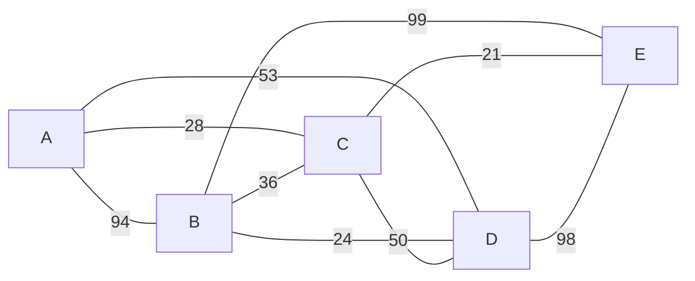

# Actividad 13. Implementación de algoritmos P, NP y con heurística

**Nombre de la actividad:** Actividad 13. Implementación de algoritmos P, NP y con heurística:
Dijkstra, problema del agente viajero y agente viajero con heurística voraz

## Equipo

| Nombre completo | No. de cuenta |
|---|---|
| Jonathan Hernández Lazcano | 200417 |
| Camila Rodriguez Rosas | 194100 |

## Instrucciones

> Se da continuidad al backend implementado en actividades anteriores, agregando nuevos endpoints:
>
> 1. **Dijkstra**
> 2. **Problema del agente viajero (TSP)**
> 3. **Problema del agente viajero con heurística voraz**
> 4. **Endpoint auxiliar:** genera grafos sintéticos ponderados.
>
> Cada endpoint de algoritmo debe retornar: tiempo de ejecución (ms), memoria consumida en tiempo de
> ejecución, No. de nodos recorridos y costo del camino encontrado.
>
> **Entregable:** archivo markdown que documente cada algoritmo y su funcionamiento, con 3 pruebas
> con grafos de 5, 10 y 15 nodos.

## Descripción

API en **FastAPI** que continúa el backend de la
[Actividad 12](../Actividad12-Algoritmos-De-Búsqueda-Informada-Heurísticos/README.md). Conserva la
búsqueda voraz y A* (`/search/greedy`, `/search/star`) y agrega cuatro endpoints:

| Endpoint | Algoritmo | Clase del problema | Complejidad | ¿Óptimo? |
|---|---|---|---|---|
| `POST /graph/dijkstra` | Dijkstra | **P** | `O((V + E) log V)` | Sí |
| `POST /graph/tsp` | Agente viajero exacto (Held-Karp) | **NP-difícil** | `O(n² · 2ⁿ)` | Sí |
| `POST /graph/tsp/greedy` | Agente viajero con heurística voraz (vecino más cercano) | Heurística | `O(n²)` | No garantizado |
| `POST /graph/generate` | Generador de grafos sintéticos ponderados | — | `O(n²)` | — |

Las tres respuestas de algoritmos incluyen **`tiempo_ms`**, **`memoria_kb`**,
**`nodos_recorridos`** y **`costo`**, además de la ruta encontrada.

Los algoritmos están escritos a mano. Solo usan la biblioteca estándar de Python: `heapq` para la
cola de prioridad de Dijkstra, `time` y `tracemalloc` para las métricas y `random` para el
generador. **No** se usa networkx ni ninguna otra librería de grafos.

## Cómo ejecutar

```bash
cd Actividad13-Implementación-De-Algoritmos-P-NP-y-Con-Heurística

python3 -m venv .venv
source .venv/bin/activate                     # Windows: .venv\Scripts\activate
pip install -r requirements.txt

# Levantar la API (documentación interactiva en http://127.0.0.1:8000/docs)
uvicorn main:app --reload

# Correr todas las pruebas de este documento (no necesita el servidor levantado)
python ejemplos/pruebas.py
```

## Estructura

```
Actividad13-.../
├── main.py              # App de FastAPI: monta los routers de las actividades 12 y 13
├── schemas.py           # Esquemas Pydantic de entrada y salida, y ejemplos de /docs
├── core/
│   ├── grafos.py        # Construcción y validación de grafos (de la Actividad 12)
│   ├── dijkstra.py      # Dijkstra                                      ← nuevo
│   ├── tsp.py           # TSP exacto (Held-Karp) y TSP voraz            ← nuevo
│   ├── generador.py     # Grafos sintéticos ponderados                  ← nuevo
│   ├── metricas.py      # Medición de tiempo y memoria                  ← nuevo
│   ├── greedy_search.py # Búsqueda voraz (Actividad 12)
│   └── star_search.py   # Búsqueda A* (Actividad 12)
├── routers/
│   ├── grafos.py        # /graph/dijkstra, /graph/tsp, /graph/tsp/greedy, /graph/generate
│   └── busqueda.py      # /search/greedy, /search/star (Actividad 12)
├── ejemplos/
│   ├── pruebas.py       # Corre y verifica todas las pruebas; imprime las tablas
│   ├── grafos.json      # Los grafos de 5, 10 y 15 nodos de las pruebas
│   └── resultados.json  # Respuestas completas de la API
├── requirements.txt
└── README.md
```

## Esquemas de entrada y salida

### Entrada

Los endpoints de algoritmos aceptan el grafo en los mismos tres formatos de la Actividad 12 (la
clase base `GrafoRequest` de `schemas.py` los comparte con `/search/*`). Se envía **exactamente
uno**:

| Campo | Formato |
|---|---|
| `lista_adyacencia` | `{"A": [["B", 94], ["C", 28]], ...}` |
| `matriz_adyacencia` + `nodos` | Matriz `n × n`; `0` o `null` = sin arista |
| `aristas` | `[["A", "B", 94], ...]` |

Además:

| Campo | Endpoints | Descripción |
|---|---|---|
| `dirigido` | todos | `false`: cada arista se recorre en ambos sentidos. Por defecto `true`. |
| `origen` | todos | Dijkstra: nodo de inicio (obligatorio). TSP: nodo donde empieza y termina el ciclo; por defecto, el primero del grafo. |
| `destino` | `/graph/dijkstra` | Nodo a alcanzar (obligatorio). |

La API responde `422` con el motivo si: el grafo viene en más de un formato o en ninguno, hay
pesos negativos (Dijkstra los prohíbe y el resto de la API también), el origen/destino no existe, o
el grafo de `/graph/tsp` tiene más de **18 nodos** (ver [Limitaciones](#limitaciones)).

### Salida: `AlgoritmoResponse`

```json
{
  "algoritmo": "Dijkstra",
  "clase": "P",
  "complejidad": "O((V + E) log V)",
  "origen": "A",
  "destino": "E",
  "num_nodos": 5,
  "solucion": true,
  "ruta": ["A", "C", "E"],
  "costo": 49.0,
  "nodos_recorridos": 3,
  "operaciones": 7,
  "tiempo_ms": 0.0112,
  "memoria_kb": 0.691,
  "motivo": "Camino de menor costo de A a E: 49."
}
```

| Campo | Significado |
|---|---|
| `solucion` | `false` si no hay camino (Dijkstra) o no se encontró un ciclo (TSP). |
| `ruta` | Camino de `origen` a `destino`, o ciclo que regresa a `origen` en el TSP. |
| `costo` | **Costo del camino encontrado**: suma de los pesos de `ruta`. `null` sin solución. |
| `nodos_recorridos` | **No. de nodos recorridos** por el algoritmo (definición por algoritmo abajo). |
| `operaciones` | Trabajo elemental: relajaciones (Dijkstra), transiciones (Held-Karp) o aristas examinadas (voraz). |
| `tiempo_ms` | **Tiempo de ejecución** del algoritmo, en milisegundos. |
| `memoria_kb` | **Memoria consumida en tiempo de ejecución**: pico de memoria reservada, en KB. |

`nodos_recorridos` se adapta al espacio que explora cada algoritmo:

| Algoritmo | Qué cuenta `nodos_recorridos` |
|---|---|
| Dijkstra | Nodos del grafo **fijados** (extraídos de la cola con su distancia definitiva). |
| TSP exacto | **Estados** `(S, j)` del espacio de búsqueda de Held-Karp que se expandieron. Cada estado es un camino parcial, así que este número crece como `n · 2ⁿ`. |
| TSP voraz | Nodos del grafo que **visitó el agente** (`n` si completa el ciclo). |

### Cómo se miden tiempo y memoria (`core/metricas.py`)

Se mide solo el algoritmo, no la validación ni la conversión del JSON. El algoritmo se ejecuta dos
veces con la misma entrada:

1. **Tiempo:** `time.perf_counter()` antes y después de la llamada.
2. **Memoria:** `tracemalloc` registra cada reserva de memoria de Python durante la llamada;
   `memoria_kb` es el **pico** (el mayor total reservado a la vez): colas, tablas de programación
   dinámica, diccionarios de distancias, la ruta, etc. El grafo de entrada no cuenta, porque ya
   existía.

Se separan porque `tracemalloc` hace más lento el código que observa; medidos juntos, el tiempo
saldría inflado. Los algoritmos son deterministas, así que ambas ejecuciones hacen exactamente el
mismo trabajo. Un candado (`threading.Lock`) evita que dos peticiones simultáneas se estorben, ya
que `tracemalloc` es global al proceso.

## P, NP y heurísticas

- **P:** problemas que se resuelven en tiempo polinomial, `O(nᵏ)`. Encontrar el camino más corto
  entre dos nodos es de esta clase: Dijkstra lo resuelve en `O((V + E) log V)`.
- **NP:** problemas cuya solución, si alguien la propone, se **verifica** en tiempo polinomial. La
  versión de decisión del TSP ("¿hay un ciclo que visite todos los nodos con costo ≤ k?") es
  NP-completa: verificar un ciclo es fácil, pero no se conoce un algoritmo polinomial que lo
  **encuentre**. La versión de optimización ("el ciclo más barato") es **NP-difícil**.
- **Heurística:** cuando el exacto es demasiado caro, se sacrifica la garantía de óptimo a cambio
  de rapidez. El vecino más cercano resuelve el TSP en `O(n²)` con una regla local simple, pero
  puede dar ciclos más caros que el óptimo o no encontrar ninguno.

Las pruebas muestran exactamente esto: Dijkstra y la voraz se mantienen en fracciones de
milisegundo, mientras que el TSP exacto pasa de 0.03 ms con 5 nodos a 108 ms con 15 y a más de un
segundo con 18.

## Algoritmos

### Dijkstra: `core/dijkstra.py`

Encuentra el camino de menor costo de `origen` a `destino` en un grafo con pesos **no negativos**.

**Idea.** Se mantiene una distancia tentativa `dist[v]` para cada nodo y una cola de prioridad con
los nodos por fijar. El nodo de la cola con menor distancia ya tiene su distancia **definitiva**:
cualquier otro camino hacia él tendría que pasar por un nodo de la cola, que ya está más lejos, y
los pesos no negativos no pueden "abaratarlo" después.

```
dist[origen] = 0;  cola = {(0, origen)}
mientras la cola no esté vacía:
    (d, u) = extraer el de menor d          # u queda fijado
    si u ya estaba fijado: descartar        # entrada obsoleta
    si u == destino: terminar
    para cada arista u → v con peso w:      # relajación
        si d + w < dist[v]:
            dist[v] = d + w;  padre[v] = u;  insertar (dist[v], v)
```

La ruta se reconstruye siguiendo `padre` desde el destino. Como el algoritmo se detiene al fijar
el destino, `nodos_recorridos` puede ser menor que el total de nodos.

**Complejidad.** Cada arista se relaja a lo más una vez por sentido y cada inserción/extracción en
el montículo binario (`heapq`) cuesta `O(log V)`: **`O((V + E) log V)`** en tiempo y `O(V + E)`
en memoria. En lugar de "disminuir la llave" se inserta una entrada nueva y la vieja se descarta al
salir (*lazy deletion*).

**Ejemplo (grafo de 5 nodos, A → E).**

| Paso | Se fija | dist | Relajaciones |
|---|---|---|---|
| 1 | A (0) | B = 94, C = 28, D = 53 | 3 |
| 2 | C (28) | B = min(94, 28 + 36) = **64**, D = min(53, 28 + 50) = 53, E = 28 + 21 = **49** | 4 |
| 3 | E (49) | destino alcanzado | — |

Resultado: `A → C → E`, costo **49**, 3 nodos recorridos, 7 relajaciones.

### Agente viajero exacto (Held-Karp): `core/tsp.py` → `tsp_exacto`

El **problema del agente viajero (TSP)** busca el ciclo más barato que sale del origen, visita
**cada nodo exactamente una vez** y regresa al origen (un ciclo hamiltoniano de costo mínimo).

**Fuerza bruta** sería probar las `(n − 1)!` permutaciones: con 15 nodos son
14! ≈ 8.7 · 10¹⁰ ciclos. **Held-Karp** usa programación dinámica para no repetir trabajo: el mejor
modo de terminar un recorrido solo depende de **qué nodos ya se visitaron** y **dónde se está**,
no del orden en que se visitaron.

Se define el estado `C(S, j)` = costo del camino más barato que sale del origen, visita
exactamente los nodos del conjunto `S` y termina en `j ∈ S`:

```
C({j}, j)       = w(origen, j)
C(S ∪ {k}, k)   = min sobre j ∈ S de  C(S, j) + w(j, k)          (k ∉ S)
óptimo          = min sobre j de      C(todos, j) + w(j, origen)
```

Implementación:

- `S` es una **máscara de bits** de `n − 1` bits (el bit `j − 1` indica si el nodo `j` está en
  `S`); la tabla `costo[máscara][j]` tiene `2ⁿ⁻¹ · (n − 1)` celdas.
- Como `S ∪ {k}` siempre es un número mayor que `S`, basta recorrer las máscaras en orden
  creciente: cuando se expande un estado, ya tiene su valor definitivo.
- La tabla `previo[máscara][j]` guarda de qué nodo se llegó, para reconstruir el ciclo.
- Las aristas que no existen valen `∞`. Los estados con costo `∞` (inalcanzables) no se
  expanden. Si al final el mínimo es `∞`, el grafo **no tiene ciclo hamiltoniano** y la respuesta
  trae `solucion: false`.

`nodos_recorridos` son los estados `(S, j)` expandidos (con costo finito) y `operaciones` las
transiciones `C(S, j) + w(j, k)` evaluadas. En un grafo completo son exactamente
`(n − 1) · 2ⁿ⁻²` estados (por ejemplo, 2 304 con 10 nodos).

**Complejidad.** `O(n² · 2ⁿ)` en tiempo y **`O(n · 2ⁿ)` en memoria**. Es exponencial, pero mucho
mejor que `O(n!)`: con 15 nodos son ~7.5 · 10⁵ transiciones (grafo completo) contra
~8.7 · 10¹⁰ permutaciones de la fuerza bruta.

### Agente viajero con heurística voraz: `core/tsp.py` → `tsp_voraz`

Heurística del **vecino más cercano**: el agente sale del origen y, desde el nodo actual, avanza
siempre por la **arista más barata hacia un nodo no visitado** (a igual peso, el primero de la
lista de adyacencia). Cuando ya visitó todos, regresa al origen.

```
actual = origen;  visitados = {origen}
mientras falten nodos:
    v = vecino no visitado de actual con menor w(actual, v)
    si no hay: fallar ("sin vecinos por visitar")
    avanzar a v
cerrar el ciclo con w(actual, origen)   (si no existe la arista: fallar)
```

Es **voraz** porque toma la mejor decisión local y **nunca la deshace**. Por eso:

- Es rápida: `n` pasos y en cada uno se revisan los vecinos del nodo actual, **`O(n²)`** en el peor
  caso, y solo guarda la ruta y el conjunto de visitados (**`O(n)`** en memoria).
- **No garantiza el óptimo:** una arista barata al principio puede obligar a tomar aristas caras al
  final. En el grafo de 5 nodos toma A–C (28) y C–E (21), las más baratas, pero desde E solo quedan
  E–D (98) y E–B (99), y termina en 265 contra el óptimo de 225.
- **Puede no encontrar ciclo aunque exista:** en un grafo incompleto el agente puede llegar a un
  nodo cuyos vecinos ya visitó todos (ver [casos adicionales](#casos-adicionales)).

`nodos_recorridos` son los nodos que visitó el agente y `operaciones` las aristas que examinó.

### Generador de grafos sintéticos: `core/generador.py`

`POST /graph/generate` crea grafos ponderados reproducibles para probar los algoritmos:

| Parámetro | Por defecto | Descripción |
|---|---|---|
| `n` | — | Número de nodos (1 a 702), nombrados A, B, …, Z, AA, AB, … |
| `densidad` | `0.5` | Probabilidad de arista entre cada par de nodos; `1` = grafo completo. |
| `peso_min`, `peso_max` | `1`, `100` | Rango de los pesos aleatorios (enteros). |
| `pesos` | `aleatorios` | `aleatorios` o `euclidianos` (distancia redondeada entre las coordenadas). |
| `dirigido` | `false` | Grafo dirigido o no dirigido. |
| `semilla` | `null` | Con la misma semilla se obtiene el mismo grafo. |

Pasos:

1. A cada nodo se le asigna una posición aleatoria `(x, y)` en `[0, 100] × [0, 100]`.
2. Se barajan los nodos y se unen en un **ciclo** `n₁ → n₂ → … → nₙ → n₁`. Así el grafo siempre es
   conexo y tiene al menos un ciclo hamiltoniano: Dijkstra encuentra camino entre cualquier par
   y el TSP exacto siempre tiene solución.
3. Cada uno de los demás pares recibe una arista con probabilidad `densidad`.
4. Se asignan los pesos.

La respuesta trae `lista_adyacencia`, `coordenadas`, `dirigido`, `num_aristas` y `densidad_real`.
**Se puede mandar tal cual** a los demás endpoints agregando `origen` (y `destino`): los campos
extra se ignoran. En grafos no dirigidos cada arista aparece una sola vez, en la fila del nodo que
va primero, y `dirigido: false` hace que se recorra en ambos sentidos.

## Endpoints

| Método | Ruta | Cuerpo | Respuesta |
|---|---|---|---|
| `POST` | `/graph/dijkstra` | grafo + `origen` + `destino` | `AlgoritmoResponse` |
| `POST` | `/graph/tsp` | grafo + `origen` (opcional) | `AlgoritmoResponse` |
| `POST` | `/graph/tsp/greedy` | grafo + `origen` (opcional) | `AlgoritmoResponse` |
| `POST` | `/graph/generate` | parámetros del generador | `GrafoGenerado` |
| `POST` | `/search/greedy`, `/search/star` | ver [Actividad 12](../Actividad12-Algoritmos-De-Búsqueda-Informada-Heurísticos/README.md) | |
| `GET` | `/` | — | `{"status": "ok"}` |

### Cómo llamarlos

```bash
# 1. Generar el grafo de 5 nodos de las pruebas
curl -s -X POST http://127.0.0.1:8000/graph/generate \
  -H 'Content-Type: application/json' \
  -d '{"n": 5, "densidad": 0.7, "semilla": 5}'

# 2. Dijkstra de A a E
curl -s -X POST http://127.0.0.1:8000/graph/dijkstra \
  -H 'Content-Type: application/json' \
  -d '{
        "lista_adyacencia": {
          "A": [["B", 94], ["C", 28], ["D", 53]],
          "B": [["C", 36], ["D", 24], ["E", 99]],
          "C": [["D", 50], ["E", 21]],
          "D": [["E", 98]],
          "E": []
        },
        "dirigido": false, "origen": "A", "destino": "E"
      }'

# 3. TSP exacto y voraz: el mismo cuerpo sin "destino"
curl -s -X POST http://127.0.0.1:8000/graph/tsp        -H 'Content-Type: application/json' -d @cuerpo.json
curl -s -X POST http://127.0.0.1:8000/graph/tsp/greedy -H 'Content-Type: application/json' -d @cuerpo.json
```

En `/docs` cada endpoint trae estos ejemplos precargados.

## Pruebas

`ejemplos/pruebas.py` corre todo contra la API en memoria (con el `TestClient` de FastAPI) y
**verifica** cada resultado con soluciones de referencia independientes del código de `core/`:

- **Dijkstra:** el costo debe ser igual al de **Floyd-Warshall** y la ruta debe costar lo que dice.
- **TSP exacto:** el ciclo debe ser hamiltoniano (sale y regresa al origen, pasa una vez por cada
  nodo) y, en los grafos de 5 y 10 nodos, su costo debe ser igual al de la **fuerza bruta** sobre
  todas las permutaciones (con 15 nodos serían 14! ≈ 8.7 · 10¹⁰ y no es viable).
- **TSP voraz:** ciclo hamiltoniano válido y con costo **≥** el óptimo.

Los tres grafos se generaron con `POST /graph/generate`, **no dirigidos**, con **densidad 0.7** y
pesos aleatorios entre 1 y 100. Están completos en [`ejemplos/grafos.json`](ejemplos/grafos.json)
y las respuestas completas de la API en [`ejemplos/resultados.json`](ejemplos/resultados.json).
Dijkstra va del primer nodo al último y el TSP sale de A.

> Los tiempos y la memoria son de una ejecución en una Mac con Python 3.14; cambian un poco entre
> corridas y entre equipos. Los costos, rutas y conteos son siempre los mismos.

### Prueba 1: grafo de 5 nodos

Generado con `{"n": 5, "densidad": 0.7, "semilla": 5}`: 9 de las 10 aristas posibles.



| Algoritmo | Solución | Ruta | Costo | Nodos recorridos | Operaciones | Tiempo (ms) | Memoria (KB) |
|---|---|---|---|---|---|---|---|
| Dijkstra (A → E) | ✅ | A → C → E | **49** | 3 | 7 | 0.0112 | 0.691 |
| TSP exacto | ✅ | A → D → B → E → C → A | **225** | 28 | 39 | 0.0296 | 2.268 |
| TSP voraz | ✅ | A → C → E → D → B → A | **265** | 5 | 18 | 0.0062 | 1.190 |

- **Dijkstra** fija A, C y E y se detiene: no necesita ver B ni D (ver el
  [paso a paso](#dijkstra-coredijkstrapy)).
- **TSP voraz:** A –28→ C –21→ E –98→ D –24→ B –94→ A = 265. Las dos primeras aristas están entre las
  más baratas del grafo, pero dejan al agente en E, cuyas aristas restantes cuestan 98 y 99.
- **TSP exacto:** A –53→ D –24→ B –99→ E –21→ C –28→ A = 225. Usa la arista cara B–E (99), pero se
  ahorra D–E (98) y B–A (94), que la voraz se vio obligada a tomar. La voraz queda **17.8 %** arriba del óptimo.
- Con 5 nodos el exacto todavía es instantáneo: solo 28 estados.

### Prueba 2: grafo de 10 nodos

Generado con `{"n": 10, "densidad": 0.7, "semilla": 7}`: 38 de 45 aristas posibles.

<details>
<summary>Lista de adyacencia (cada arista aparece una vez)</summary>

| Nodo | Aristas |
|---|---|
| A | B 97, C 44, E 20, G 63, H 54, I 6, J 86 |
| B | C 10, D 98, E 72, G 74, H 41, I 44, J 89 |
| C | D 45, E 77, F 64, G 75, H 59, I 9, J 12 |
| D | E 35, F 61, G 90, H 86, I 9, J 8 |
| E | F 94, H 90, I 40, J 83 |
| F | G 74, H 88, I 58 |
| G | I 37, J 92 |
| H | J 50 |
| I | J 86 |

</details>

| Algoritmo | Solución | Ruta | Costo | Nodos recorridos | Operaciones | Tiempo (ms) | Memoria (KB) |
|---|---|---|---|---|---|---|---|
| Dijkstra (A → J) | ✅ | A → I → D → J | **23** | 6 | 40 | 0.0101 | 1.699 |
| TSP exacto | ✅ | A → I → G → F → H → B → C → J → D → E → A | **331** | 2 193 | 7 344 | 1.6090 | 183.395 |
| TSP voraz | ✅ | A → I → C → B → H → J → D → E → F → G → A | **390** | 10 | 76 | 0.0080 | 1.253 |

- **Dijkstra:** la arista directa A–J cuesta 86, pero A –6→ I –9→ D –8→ J cuesta solo 23. Fija 6
  de los 10 nodos antes de llegar a J.
- **TSP exacto:** 2 193 estados y 7 344 transiciones; ya es ~160 veces más lento que Dijkstra y usa
  ~180 KB, contra ~1.7 KB.
- **TSP voraz:** 390, un **17.8 %** arriba del óptimo, en 0.008 ms y con memoria constante.

### Prueba 3: grafo de 15 nodos

Generado con `{"n": 15, "densidad": 0.7, "semilla": 4}`: 81 de 105 aristas posibles.

<details>
<summary>Lista de adyacencia (cada arista aparece una vez)</summary>

| Nodo | Aristas |
|---|---|
| A | B 53, C 63, F 5, G 29, I 54, L 57, M 32, N 83, O 55 |
| B | C 28, D 64, E 25, F 5, H 5, I 33, J 33, K 32, L 68, M 27, N 99, O 30 |
| C | E 54, F 34, G 19, H 42, I 7, J 41, K 73, M 15, N 73 |
| D | E 52, F 84, G 84, H 92, J 96, K 6, L 64, M 50, N 12, O 56 |
| E | F 27, G 74, L 22, M 44, N 38 |
| F | H 85, J 61, K 83, M 41, N 54, O 68 |
| G | H 28, I 84, K 88, L 35, M 44, N 51, O 64 |
| H | I 10, J 36, L 81, M 86, N 25 |
| I | J 6, K 51, L 80, M 17, N 99, O 35 |
| J | K 86, L 8, M 22, N 89, O 82 |
| K | L 60, N 73, O 61 |
| L | M 96, O 52 |
| M | O 50 |
| N | O 28 |

</details>

| Algoritmo | Solución | Ruta | Costo | Nodos recorridos | Operaciones | Tiempo (ms) | Memoria (KB) |
|---|---|---|---|---|---|---|---|
| Dijkstra (A → O) | ✅ | A → F → B → O | **40** | 12 | 118 | 0.0194 | 2.137 |
| TSP exacto | ✅ | A → G → C → M → O → N → D → K → B → H → I → J → L → E → F → A | **274** | 111 790 | 567 778 | 108.4164 | 8 259.975 |
| TSP voraz | ✅ | A → F → B → H → I → J → L → E → N → D → K → O → M → C → G → A | **291** | 15 | 162 | 0.0115 | 1.253 |

- **Dijkstra:** A –5→ F –5→ B –30→ O = 40, contra 55 de la arista directa A–O. Fija 12 nodos.
- **TSP exacto:** 111 790 estados, **108 ms** y **~8 MB**. Al pasar de 10 a 15 nodos el tiempo se
  multiplicó por ~67 y la memoria por ~45, mientras que en Dijkstra apenas se duplicaron.
- **TSP voraz:** 291, solo un **6.2 %** arriba del óptimo, **~9 400 veces más rápida** que el
  exacto.

### Resumen

| Grafo | Aristas | Dijkstra: costo · recorridos · ms · KB | TSP exacto: costo · estados · ms · KB | TSP voraz: costo · recorridos · ms · KB | Voraz / óptimo |
|---|---|---|---|---|---|
| 5 nodos | 9 | 49 · 3 · 0.0112 · 0.691 | 225 · 28 · 0.0296 · 2.268 | 265 · 5 · 0.0062 · 1.190 | 1.178 |
| 10 nodos | 38 | 23 · 6 · 0.0101 · 1.699 | 331 · 2 193 · 1.6090 · 183.395 | 390 · 10 · 0.0080 · 1.253 | 1.178 |
| 15 nodos | 81 | 40 · 12 · 0.0194 · 2.137 | 274 · 111 790 · 108.4164 · 8 259.975 | 291 · 15 · 0.0115 · 1.253 | 1.062 |

## Casos adicionales

### La voraz se queda sin salida

Grafo de 10 nodos con `{"n": 10, "densidad": 0.7, "semilla": 1}` (27 aristas), TSP desde A:

| Algoritmo | Solución | Ruta | Costo | Nodos recorridos | Tiempo (ms) | Memoria (KB) |
|---|---|---|---|---|---|---|
| TSP exacto | ✅ | A → G → D → I → J → E → F → H → B → C → A | 428 | 1 390 | 0.8337 | 164.598 |
| TSP voraz | ❌ | — | — | 9 | 0.0059 | 1.410 |

> *El agente quedó en G sin vecinos por visitar tras recorrer 9 de 10 nodos
> (A → D → I → B → H → F → E → J → G).*

El ciclo existe (el generador siempre garantiza uno), pero la voraz dejó a C para el final y
llegó a G, que no tiene arista hacia C. Al explorar semillas para las pruebas, con densidad 0.35 a
0.4 la voraz falló en 9 de 10 grafos de 10 y 15 nodos; con grafos completos nunca falla.

### Escalabilidad: P contra NP

Grafos **completos** (densidad 1, semilla 1) de 4 a 18 nodos:

| n | Dijkstra (ms) | TSP exacto: estados | TSP exacto (ms) | TSP exacto (KB) | TSP voraz (ms) | TSP voraz (KB) | Voraz / óptimo |
|---|---|---|---|---|---|---|---|
| 4 | 0.0066 | 12 | 0.0125 | 1.307 | 0.0029 | 0.690 | 1.000 |
| 6 | 0.0067 | 80 | 0.0430 | 4.174 | 0.0049 | 1.190 | 1.275 |
| 8 | 0.0079 | 448 | 0.2436 | 35.933 | 0.0046 | 1.253 | 1.028 |
| 10 | 0.0088 | 2 304 | 1.4707 | 186.012 | 0.0063 | 1.253 | 1.000 |
| 12 | 0.0120 | 11 264 | 9.2521 | 871.810 | 0.0070 | 1.253 | 1.561 |
| 14 | 0.0167 | 53 248 | 50.1035 | 3 935.927 | 0.0147 | 1.276 | 1.434 |
| 16 | 0.0207 | 245 760 | 274.9373 | 17 563.225 | 0.0125 | 1.339 | 1.277 |
| 18 | 0.0148 | 1 114 112 | 1 358.0140 | 77 492.624 | 0.0147 | 1.339 | 1.385 |

- Los estados del TSP exacto siguen exactamente `(n − 1) · 2ⁿ⁻²`, y el tiempo y la memoria se
  multiplican por ~5 cada 2 nodos. Con 18 nodos ya tarda **1.4 s** y reserva **~76 MB**;
  extrapolando, con 25 nodos serían varios minutos y más de 10 GB.
- Dijkstra y la voraz se quedan alrededor de 0.02 ms o menos en todos los tamaños.
- La calidad de la voraz es irregular: unas veces da el óptimo (n = 4, 10) y otras queda hasta
  **56 %** arriba (n = 12).

### Errores de validación (`422`)

| Petición | Mensaje |
|---|---|
| `/graph/tsp` con 19 nodos | El TSP exacto admite hasta 18 nodos y el grafo tiene 19: su costo es O(n² · 2ⁿ). Usa /graph/tsp/greedy para grafos grandes. |
| `/graph/dijkstra` con origen `Z` | El origen 'Z' no es un nodo del grafo. |
| `/graph/dijkstra` con una arista de peso −3 | La arista A → B tiene peso negativo (-3); los algoritmos requieren pesos ≥ 0. |

Con el mismo grafo de 19 nodos, `/graph/tsp/greedy` sí responde: costo 346 en ~0.02 ms.

## Observaciones

1. **La diferencia entre P y NP se ve en los números.** Al pasar de 5 a 15 nodos, Dijkstra pasó de
   0.011 a 0.019 ms; el TSP exacto, de 0.03 a 108 ms (×3 600) y de 2 KB a 8 MB. Ningún ajuste de
   implementación cambia esa tendencia: es la forma de `2ⁿ`.
2. **La memoria también es exponencial en Held-Karp.** A diferencia de la fuerza bruta, que solo
   guarda la permutación actual, la programación dinámica cambia tiempo por memoria: la tabla de
   `n · 2ⁿ` estados es lo que primero se vuelve impráctico.
3. **La heurística voraz es un buen compromiso en grafos completos.** En las 3 pruebas quedó entre
   6 % y 18 % arriba del óptimo, en una fracción de milisegundo y con memoria prácticamente
   constante. Pero **no tiene garantía**: llegó a 56 % arriba en la tabla de escalabilidad.
4. **En grafos dispersos la voraz es frágil.** Como nunca retrocede, puede quedarse en un nodo sin
   salida aunque exista un ciclo, algo que al exacto nunca le pasa.
5. **Dijkstra se detiene pronto.** Al parar en cuanto fija el destino, recorrió 3 de 5, 6 de 10 y
   12 de 15 nodos. Y en los grafos de 10 y 15 nodos el camino óptimo **no** es la arista directa al
   destino.
6. **Los nodos recorridos no son comparables entre algoritmos.** En Dijkstra y la voraz son nodos
   del grafo (`≤ n`); en Held-Karp son estados del espacio de búsqueda, que es lo que realmente
   recorre ese algoritmo, y por eso crecen hasta 111 790 con 15 nodos.

## Limitaciones

- **El TSP exacto está limitado a 18 nodos** para que una petición no tarde minutos ni agote la
  memoria del servidor; arriba de eso responde `422` y sugiere la voraz.
- **Pesos no negativos.** Dijkstra no funciona con pesos negativos (necesitaría Bellman-Ford), así
  que la API los rechaza.
- **La voraz siempre sale del `origen`.** Una variante común es repetirla desde cada nodo y
  quedarse con el mejor ciclo, o mejorarla después con 2-opt; no se implementaron para mantener la
  heurística pura.
- **`memoria_kb` es memoria de Python** medida con `tracemalloc`: incluye las estructuras que crea
  el algoritmo, no la memoria total del proceso ni la del intérprete.
- **Los tiempos son de una sola ejecución** y en algoritmos tan rápidos como Dijkstra (centésimas
  de milisegundo) el ruido del sistema pesa; sirven para comparar órdenes de magnitud.
