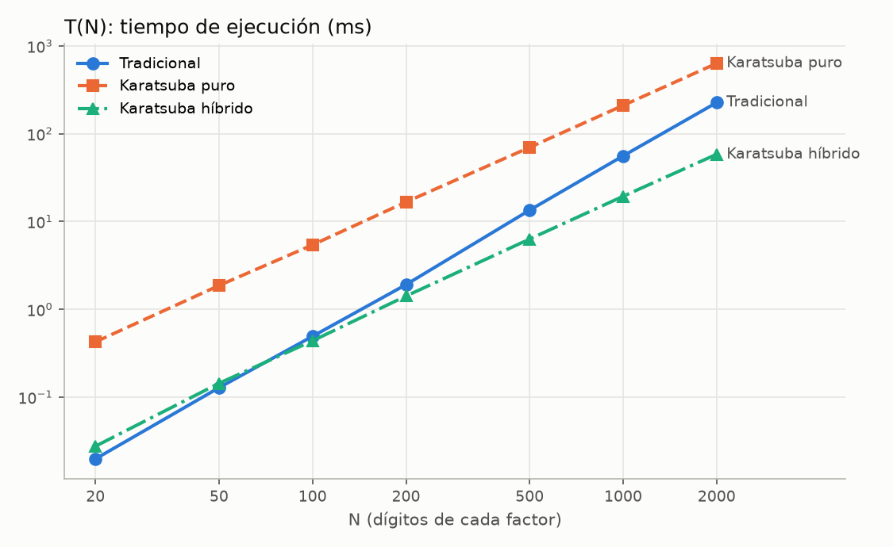
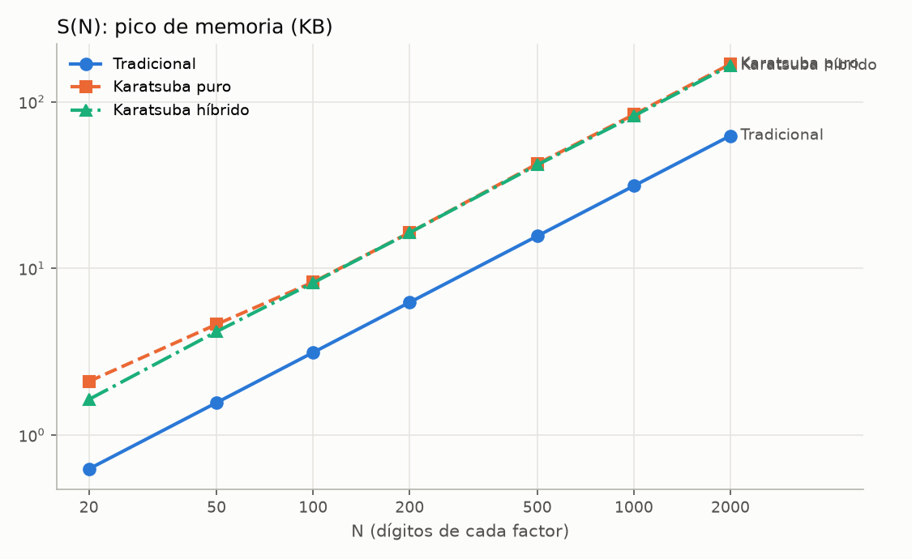
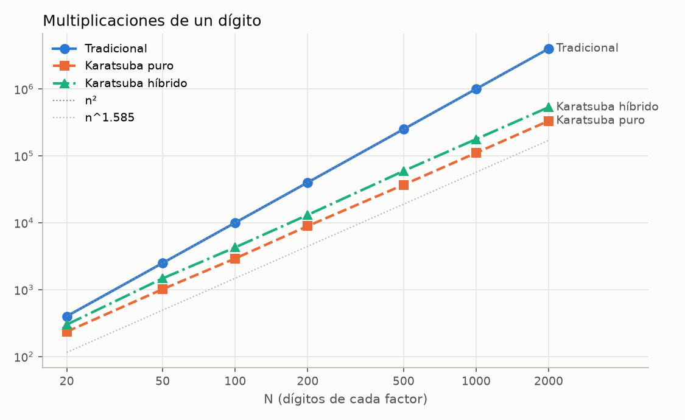

# Actividad 14. Implementación de la estrategia Divide y Vencerás

**Nombre de la actividad:** Actividad 14. Implementación de la estrategia Divide y Vencerás:
algoritmo de Karatsuba para multiplicar enteros gigantes

## Equipo

| Nombre completo | No. de cuenta |
|---|---|
| Jonathan Hernández Lazcano | 200417 |
| Camila Rodriguez Rosas | 194100 |

## Instrucciones

> Investiga e implementa el algoritmo **Karatsuba** para multiplicar de forma eficiente números
> enteros gigantes, reduciendo la cantidad de multiplicaciones necesarias para resolver una
> multiplicación grande.
>
> - Implementar Karatsuba en su forma **recursiva**.
> - Multiplicar enteros de al menos **20, 50 y 100 dígitos**.
> - Medir el tiempo **T(N)** y el espacio **S(N)** de las variantes implementadas.
> - Comparar los resultados y el desempeño contra la multiplicación sin Karatsuba.

## Descripción

API en **FastAPI** (mismo esquema que las actividades 12 y 13) con tres variantes de multiplicación
de enteros grandes, escritas a mano sobre **listas de dígitos**:

| Variante | Archivo | T(N) | S(N) |
|---|---|---|---|
| Tradicional (escolar), **sin Karatsuba** | `core/tradicional.py` | `O(n²)` | `O(n)` |
| Karatsuba recursivo **puro** (divide hasta 1 dígito) | `core/karatsuba.py` | `O(n^1.585)` | `O(n)` |
| Karatsuba recursivo **híbrido** (usa la escolar en subproblemas de ≤ 16 dígitos) | `core/karatsuba.py` | `O(n^1.585)` | `O(n)` |

| Endpoint | Qué hace |
|---|---|
| `POST /multiply/tradicional` | Multiplicación escolar |
| `POST /multiply/karatsuba` | Karatsuba recursivo; `umbral = 1` (puro, por defecto) o `> 1` (híbrido) |
| `POST /multiply/comparar` | Corre las tres variantes, verifica que coinciden con la referencia y calcula la aceleración |
| `POST /multiply/generate` | Genera dos enteros aleatorios de exactamente N dígitos |

Cada respuesta incluye **`tiempo_ms`** (T(N)), **`memoria_kb`** (S(N)), el número de
**multiplicaciones de un dígito**, las **llamadas recursivas** y la **profundidad** de la
recursión.

> **¿Por qué listas de dígitos y no `int`?** Python ya multiplica enteros grandes con Karatsuba
> internamente (a partir de ~70 "palabras" de 30 bits). Si usáramos `a * b` con los números
> grandes estaríamos comparando Karatsuba contra Karatsuba. Por eso ambos algoritmos solo
> multiplican **dígitos sueltos (0-9)** entre sí; el `*` nativo se usa únicamente como
> **referencia** para verificar los resultados en las pruebas.

## Cómo ejecutar

```bash
cd Actividad14-Implementación-De-Estrategia-Divide-Y-Vencerás

python3 -m venv .venv
source .venv/bin/activate                     # Windows: .venv\Scripts\activate
pip install -r requirements.txt

# Levantar la API (documentación interactiva en http://127.0.0.1:8000/docs)
uvicorn main:app --reload

# Correr todas las pruebas y mediciones (no necesita el servidor; ~20 s)
python ejemplos/pruebas.py
```

## Estructura

```
Actividad14-.../
├── main.py                  # App de FastAPI
├── schemas.py               # Esquemas Pydantic de entrada y salida, y ejemplos de /docs
├── core/
│   ├── digitos.py           # Enteros como listas de dígitos: parsear, sumar, restar, ×10^k
│   ├── tradicional.py       # Multiplicación escolar O(n²)
│   ├── karatsuba.py         # Karatsuba recursivo (puro e híbrido)
│   ├── generador.py         # Enteros aleatorios de N dígitos
│   └── metricas.py          # Medición de T(N) y S(N)
├── routers/
│   └── multiplicacion.py    # /multiply/tradicional, /karatsuba, /comparar, /generate
├── ejemplos/
│   ├── pruebas.py           # Pruebas de funcionamiento + mediciones; imprime las tablas
│   └── resultados.json      # Todas las mediciones
├── img/                     # Gráficas de T(N), S(N) y multiplicaciones
├── requirements.txt
└── README.md
```

## Divide y vencerás

Estrategia de diseño de algoritmos en tres pasos:

1. **Dividir** el problema en subproblemas más pequeños del mismo tipo.
2. **Vencer** cada subproblema recursivamente (o directamente, si es lo bastante pequeño: el
   **caso base**).
3. **Combinar** las soluciones de los subproblemas en la del problema original.

Su costo se describe con una recurrencia `T(n) = a·T(n/b) + f(n)`: `a` subproblemas de tamaño
`n/b`, más `f(n)` para dividir y combinar. El **Teorema Maestro** la resuelve: si
`f(n) = O(n^c)` con `c < log_b a`, entonces `T(n) = Θ(n^(log_b a))`. Es decir, el costo lo
dominan las hojas del árbol de recursión, y **reducir `a`** (cuántos subproblemas se generan) es
lo que baja el exponente.

## Multiplicación tradicional: `core/tradicional.py`

La que se hace en papel: cada dígito de `x` por cada dígito de `y`, acumulando en la posición
`i + j` y propagando el acarreo.

```
           1 2 3 4
         × 5 6 7 8
         ---------
           9 8 7 2     ← 1234 · 8
         8 6 3 8       ← 1234 · 7
       7 4 0 4         ← 1234 · 6
     6 1 7 0           ← 1234 · 5
     -------------
     7 0 0 6 6 5 2
```

- **T(n):** exactamente `n · m` multiplicaciones de un dígito → `O(n²)`.
- **S(n):** el arreglo del resultado, de `n + m` posiciones → `O(n)`.

## Karatsuba: `core/karatsuba.py`

Anatoli Karatsuba (1960) demostró que dos números de `n` dígitos se pueden multiplicar con
**menos de `n²`** multiplicaciones de un dígito, refutando una conjetura de Kolmogorov.

### Idea

Se parte cada número en una mitad alta y una baja de `m = ⌊n/2⌋` dígitos:

```
x = a · 10^m + b
y = c · 10^m + d

x · y = ac · 10^(2m) + (ad + bc) · 10^m + bd
```

Calculado así hacen falta **4** productos de la mitad de tamaño (`ac`, `ad`, `bc`, `bd`):
`T(n) = 4T(n/2) + O(n) = O(n^log₂4) = O(n²)`. **No se gana nada.**

El truco de Karatsuba es obtener el término central `ad + bc` con un solo producto,
reutilizando los otros dos:

```
z2 = a · c
z0 = b · d
z1 = (a + b)(c + d) − z2 − z0        ← = ac + ad + bc + bd − ac − bd = ad + bc

x · y = z2 · 10^(2m) + z1 · 10^m + z0
```

**3** productos en vez de 4, a cambio de algunas sumas y restas extra, que son `O(n)`.

### Pseudocódigo

```
karatsuba(x, y):
    n = max(dígitos(x), dígitos(y))
    si n ≤ umbral:                           # caso base
        regresar escolar(x, y)              #   umbral = 1 → un dígito × un dígito
    m = n / 2
    a, b = x / 10^m, x mod 10^m             # dividir (con listas: rebanar)
    c, d = y / 10^m, y mod 10^m
    z2 = karatsuba(a, c)                    # vencer: 3 llamadas recursivas
    z0 = karatsuba(b, d)
    z1 = karatsuba(a + b, c + d) − z2 − z0
    regresar z2·10^(2m) + z1·10^m + z0      # combinar: desplazar y sumar
```

### Ejemplo a mano: 1234 × 5678

```
n = 4, m = 2
x = 1234 → a = 12, b = 34
y = 5678 → c = 56, d = 78

z2 = 12 · 56            =    672
z0 = 34 · 78            =   2652
     (12 + 34)(56 + 78) = 46 · 134 = 6164
z1 = 6164 − 672 − 2652  =   2840

x · y = 672 · 10⁴ + 2840 · 10² + 2652
      = 6 720 000 + 284 000 + 2 652
      = 7 006 652  ✓
```

Los tres subproductos se vuelven a resolver con Karatsuba. Ojo: `(a + b)` y `(c + d)` pueden
tener un dígito más que las mitades (`134` tiene 3), así que esa rama es un poco más cara. En
total la API reporta **17** multiplicaciones de un dígito para este caso, contra **16** de la
escolar: con números tan chicos Karatsuba **no** ahorra nada. La ventaja aparece al crecer N
(ver [Resultados](#resultados-tn-y-sn)): con 20 dígitos ya ahorra el 41 % y con 100, el 71 %.

### Representación: `core/digitos.py`

Los números son listas de dígitos **little-endian** (unidades primero): `"1234" → [4, 3, 2, 1]`.
Así:

- la mitad baja `b` es simplemente `x[:m]` y la alta `a` es `x[m:]`;
- multiplicar por `10^k` es anteponer `k` ceros (`desplazar`);
- `sumar` y `restar` recorren la lista arrastrando el acarreo o el préstamo, en `O(n)`.

El signo se maneja aparte (el producto es negativo si exactamente un factor lo es) y los ceros a la
izquierda se eliminan al leer la entrada.

### Variantes

- **Puro** (`umbral = 1`): divide hasta llegar a un dígito por lado. Es la forma "de libro".
- **Híbrido** (`umbral = 16`): cuando el subproblema tiene 16 dígitos o menos, lo resuelve con la
  escolar. Para números chicos la escolar es más rápida (un doble ciclo simple contra miles de
  llamadas recursivas y listas temporales), así que cortar antes la recursión reduce mucho la
  constante sin cambiar el orden de crecimiento. Es lo que hacen las bibliotecas reales (GMP,
  CPython, Java `BigInteger`).

### Análisis de T(N)

```
T(n) = 3·T(n/2) + O(n)
```

`a = 3`, `b = 2`, `f(n) = O(n¹)` y `1 < log₂3 ≈ 1.585` → por el Teorema Maestro:

```
T(n) = Θ(n^log₂3) ≈ Θ(n^1.585)
```

El árbol de recursión tiene `log₂ n` niveles; el nivel `k` tiene `3^k` llamadas de tamaño `n/2^k`.
Las hojas (productos de un dígito) son `3^log₂n = n^log₂3`. Para `n = 100`: `100^1.585 ≈ 1 479`
contra `100² = 10 000`.

### Análisis de S(N)

Las llamadas se ejecutan **una tras otra** (no en paralelo), así que en cada momento solo vive una
rama del árbol: la llamada de tamaño `n`, una de tamaño `n/2`, una de `n/4`... Cada una guarda
listas de su tamaño (mitades, sumas, `z0`, `z1`, `z2`):

```
S(n) = S(n/2) + O(n) = O(n + n/2 + n/4 + ...) = O(2n) = O(n)
```

más la pila de recursión, de profundidad `⌈log₂ n⌉`. La escolar también es `O(n)`, pero con una
constante menor: solo el arreglo del resultado.

## Esquemas de entrada y salida

### Entrada

```json
{ "a": "1234", "b": "-5678", "umbral": 1, "repeticiones": 5 }
```

| Campo | Endpoints | Descripción |
|---|---|---|
| `a`, `b` | todos menos `/generate` | Factores como **cadenas** de dígitos (admiten `-` y ceros a la izquierda). Se usan cadenas porque JSON/JavaScript no representan enteros de más de ~16 dígitos sin perder precisión. Máximo 5 000 dígitos. |
| `umbral` | `/karatsuba` (default 1), `/comparar` (default 16) | Tamaño en dígitos en el que se deja de dividir. |
| `repeticiones` | todos menos `/generate` | Veces que se mide el tiempo; se reporta la mediana. Default 5. |
| `n`, `semilla` | `/generate` | Dígitos de cada número y semilla opcional. |

La API responde `422` si un factor no es un entero en base 10 (`"12a"`, `"1.5"`, `""`) o tiene
más de 5 000 dígitos, o si `umbral < 1`.

### Salida: `MultiplicacionResponse`

```json
{
  "algoritmo": "Karatsuba recursivo (puro)",
  "complejidad_tiempo": "O(n^log₂3) ≈ O(n^1.585)",
  "complejidad_espacio": "O(n)",
  "a": "1234",
  "b": "5678",
  "producto": "7006652",
  "num_digitos": 4,
  "digitos_producto": 7,
  "multiplicaciones": 17,
  "llamadas_recursivas": 25,
  "profundidad": 3,
  "umbral": 1,
  "tiempo_ms": 0.0262,
  "memoria_kb": 0.578
}
```

| Campo | Significado |
|---|---|
| `num_digitos` | **N**: dígitos del factor más largo. |
| `multiplicaciones` | Multiplicaciones de **un dígito por un dígito**. Es la medida que Karatsuba reduce. |
| `llamadas_recursivas` | Llamadas a la función recursiva (0 en la tradicional). |
| `profundidad` | Nivel más profundo de la recursión (0 en la tradicional). |
| `tiempo_ms` | **T(N)**: mediana del tiempo de ejecución, en milisegundos. |
| `memoria_kb` | **S(N)**: pico de memoria reservada durante la ejecución, en KB. |

`/multiply/comparar` devuelve las tres respuestas en `resultados`, más `coinciden` (las tres son
iguales al producto nativo de Python), `aceleracion_puro`, `aceleracion_hibrido` (tiempo
tradicional / tiempo Karatsuba) y `ahorro_multiplicaciones`.

### Cómo se miden T(N) y S(N) (`core/metricas.py`)

Se mide solo el algoritmo, no la validación ni la conversión de cadenas. Se ejecuta por separado
para cada métrica:

1. **T(N):** `time.perf_counter()` alrededor de la llamada, repetida `repeticiones` veces; se
   reporta la **mediana**, porque con 20 dígitos una multiplicación dura microsegundos y una sola
   medición es muy ruidosa.
2. **S(N):** `tracemalloc` registra cada reserva de memoria de Python durante una ejecución;
   se reporta el **pico**: listas de dígitos temporales, mitades, sumas y el resultado. Las
   entradas no cuentan, porque ya existían.

Se separan porque `tracemalloc` hace más lento el código que observa. Un candado
(`threading.Lock`) evita que dos peticiones simultáneas se estorben, ya que `tracemalloc` es
global al proceso.

## Pruebas de funcionamiento

`python ejemplos/pruebas.py` multiplica con las **tres variantes** a través de
`/multiply/comparar` y verifica que el producto sea idéntico al de la multiplicación nativa de
Python:

| Grupo | Casos |
|---|---|
| Obligatorios | Un par de **20**, uno de **50** y uno de **100** dígitos (`/multiply/generate` con semilla = N) |
| Casos borde (10) | `0 × 0`, `0 × 20 dígitos`, `7 × 8`, `1234 × 5678`, `9…9 × 9…9` (100 nueves, máximo acarreo), potencias de 10, signo y longitudes distintas, ambos negativos, ceros a la izquierda, 100 dígitos × 1 dígito |
| Aleatorios (300) | Longitudes de 1 a 150 dígitos, distintas entre sí, ~30 % negativos |
| Entradas inválidas (4) | `"12a"`, `""`, `"1.5"` y `umbral = 0` → `422` |

**Todas pasan.** Los productos de las pruebas obligatorias:

**N = 20**

```
a     = 34159206611257976335
b     = 65618761393031134444
a × b = 2241484827999388784599728275888755382740
```

**N = 50**

```
a     = 84537518538125155331599611956035461374972493891691
b     = 97688279841582050967832912463508013486796671615001
a × b = 8258324768065300545998204568780428481600886258759155735133083348278215615443790144095472076544856691
```

**N = 100**

```
a     = 3772656818117403534322355636784621209629232037629809398495858576014643687942095204109348939557017381
b     = 4061629780720703321023114160867757839946236194641330640440084360134019557021095822005862667332998417
a × b = 15323135284904656029178639265791349238448348860337293032601741852875966431722905110671159427582791031943272823327521043788903905745027441999130100491403158731863835775453649571613194191130596114485877
```

## Resultados: T(N) y S(N)

Medidos con Python 3.14 en una Mac con Apple Silicon. Los tamaños obligatorios van en **negritas**;
200 a 2 000 se agregaron para que se vea la tendencia. Tiempo: mediana de 50 repeticiones
(N ≤ 100), 10 (N ≤ 500) o 3 (N ≥ 1000). Todos los datos están en
[`ejemplos/resultados.json`](ejemplos/resultados.json).

### T(N): tiempo de ejecución (ms)

| N | Tradicional | Karatsuba puro | Karatsuba híbrido |
|---:|---:|---:|---:|
| **20** | 0.0198 | 0.4259 | 0.0276 |
| **50** | 0.1282 | 1.8693 | 0.1438 |
| **100** | 0.4928 | 5.4246 | 0.4385 |
| 200 | 1.9127 | 16.6930 | 1.4173 |
| 500 | 13.4860 | 69.9952 | 6.3201 |
| 1000 | 55.9768 | 210.2079 | 19.4037 |
| 2000 | 226.4780 | 633.3386 | 58.3874 |



### S(N): pico de memoria (KB)

| N | Tradicional | Karatsuba puro | Karatsuba híbrido |
|---:|---:|---:|---:|
| **20** | 0.625 | 2.094 | 1.633 |
| **50** | 1.562 | 4.609 | 4.172 |
| **100** | 3.125 | 8.266 | 8.188 |
| 200 | 6.250 | 16.391 | 16.375 |
| 500 | 15.625 | 42.398 | 41.797 |
| 1000 | 31.250 | 83.727 | 82.141 |
| 2000 | 62.500 | 168.469 | 165.023 |



### Multiplicaciones de un dígito

| N | Tradicional | Karatsuba puro | Karatsuba híbrido |
|---:|---:|---:|---:|
| **20** | 400 | 235 | 300 |
| **50** | 2,500 | 1,015 | 1,471 |
| **100** | 10,000 | 2,921 | 4,274 |
| 200 | 40,000 | 8,919 | 13,081 |
| 500 | 250,000 | 36,869 | 59,260 |
| 1000 | 1,000,000 | 110,635 | 177,485 |
| 2000 | 4,000,000 | 332,797 | 532,492 |



### Recursión

| N | Llamadas (puro) | Llamadas (híbrido) | Profundidad (puro) | Profundidad (híbrido) |
|---:|---:|---:|---:|---:|
| **20** | 352 | 4 | 6 | 1 |
| **50** | 1,522 | 13 | 8 | 2 |
| **100** | 4,381 | 40 | 9 | 3 |
| 200 | 13,378 | 121 | 10 | 4 |
| 500 | 55,303 | 463 | 11 | 6 |
| 1000 | 165,952 | 1,438 | 12 | 7 |
| 2000 | 499,195 | 4,276 | 13 | 8 |

La profundidad crece como `log₂ n` (un nivel más cada vez que N se duplica), como predice el
análisis.

### Comparación contra la tradicional

| N | Aceleración puro | Aceleración híbrido | Multiplicaciones ahorradas (puro) |
|---:|---:|---:|---:|
| **20** | 0.05× | 0.72× | 41.2 % |
| **50** | 0.07× | 0.89× | 59.4 % |
| **100** | 0.09× | **1.12×** | 70.8 % |
| 200 | 0.12× | 1.35× | 77.7 % |
| 500 | 0.19× | 2.13× | 85.2 % |
| 1000 | 0.27× | 2.88× | 88.9 % |
| 2000 | 0.36× | **3.88×** | 91.7 % |

Aceleración = tiempo tradicional / tiempo Karatsuba (> 1 significa que Karatsuba es más rápido).

### Exponente medido (ajuste log-log)

Pendiente de la recta de mínimos cuadrados de `log(medida)` contra `log(N)`. El tiempo se ajusta
con N ≥ 100, donde ya no domina el costo fijo de cada llamada.

| Variante | Multiplicaciones | Tiempo | Teórico |
|---|---:|---:|---:|
| Tradicional | 2.000 | 2.058 | 2 |
| Karatsuba puro | 1.573 | 1.586 | 1.585 |
| Karatsuba híbrido | 1.619 | 1.632 | 1.585 (asintótico) |

### Efecto del umbral de la variante híbrida (N = 1000)

| Umbral | Tiempo (ms) | Memoria (KB) | Multiplicaciones | Llamadas | Profundidad |
|---:|---:|---:|---:|---:|---:|
| 1 (puro) | 208.52 | 83.7 | 110,635 | 165,952 | 12 |
| 2 | 91.32 | 82.2 | 104,128 | 52,921 | 10 |
| 4 | 45.59 | 82.1 | 109,821 | 16,885 | 9 |
| 8 | 26.76 | 82.1 | 134,749 | 5,137 | 8 |
| 16 | 19.21 | 82.1 | 177,485 | 1,438 | 7 |
| 32 | **17.43** | 82.1 | 239,327 | 388 | 6 |
| 64 | 18.72 | 82.1 | 318,860 | 121 | 4 |
| 128 | 22.30 | 82.1 | 424,007 | 40 | 3 |
| 256 | 29.25 | 82.1 | 563,502 | 13 | 2 |

## Conclusiones

1. **Karatsuba sí reduce las multiplicaciones**, y cada vez más conforme crece N: 41 % menos con
   20 dígitos, 71 % con 100 y 92 % con 2 000. El exponente medido (1.573) coincide con el teórico
   `log₂3 ≈ 1.585`, contra exactamente 2 de la tradicional.
2. **Menos multiplicaciones no significa automáticamente menos tiempo.** En Python, una llamada
   recursiva, rebanar listas y crear listas temporales cuesta mucho más que multiplicar dos
   dígitos. Por eso el **Karatsuba puro es más lento** que la escolar en todo el rango medido
   (0.05× a 0.36×), aunque la brecha se cierra: su tiempo crece como `n^1.586` y el de la escolar
   como `n^2.058`. Extrapolando, el puro alcanzaría a la escolar alrededor de los **~17 000
   dígitos**.
3. **El híbrido combina lo mejor de ambos**: usa Karatsuba para dividir los números grandes y la
   escolar cuando el subproblema ya es chico. Empata con la escolar alrededor de **N ≈ 100**
   (1.12×) y es **3.9× más rápido con 2 000 dígitos**. En 20 y 50 dígitos todavía pierde un poco
   (0.72× y 0.89×): ahí apenas hay uno o dos niveles de recursión y el costo de combinar no se
   recupera.
4. **El umbral importa**: con N = 1000, pasar de umbral 1 a 32 hace el algoritmo **12× más
   rápido**. Umbrales demasiado altos vuelven a perder, porque la escolar `O(n²)` hace demasiado
   trabajo en hojas grandes. El óptimo en esta máquina está entre 16 y 64.
5. **S(N) es lineal en las tres variantes**: la memoria se duplica cada vez que N se duplica. La
   escolar usa la menor (solo el arreglo del resultado, `2n` posiciones); Karatsuba usa unas
   **2.7 veces más** por las listas temporales de la rama activa de la recursión, pero sigue
   siendo `O(n)`, como predice `S(n) = S(n/2) + O(n)`. El umbral casi no la afecta, porque el
   pico lo dominan los niveles más altos (los de las listas más grandes).

## Limitaciones

- **Base 10 y Python puro.** Cada "dígito" es un objeto `int` de Python en una lista; una
  implementación real (GMP, CPython) usa palabras de 30 o 64 bits y C, con constantes cientos de
  veces menores. Las conclusiones sobre el **crecimiento** (exponentes, ahorro de
  multiplicaciones) son las mismas; los milisegundos absolutos no.
- **`tracemalloc` solo ve la memoria de Python.** Los marcos de la pila de recursión se reservan
  aparte y no aparecen en `memoria_kb`; con profundidad `log₂ n` (13 niveles para N = 2000) su
  aporte es pequeño.
- **Límite de 5 000 dígitos** por factor para que una petición a la API no tarde demasiado (la
  escolar con 5 000 dígitos ya tarda más de un segundo).
- Los tiempos cambian un poco entre ejecuciones y entre equipos; las multiplicaciones, llamadas y
  profundidad son deterministas.
